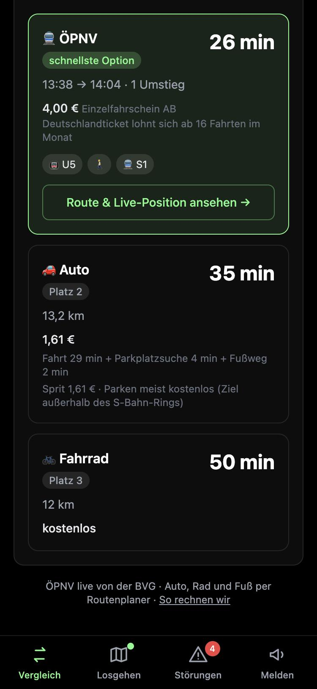
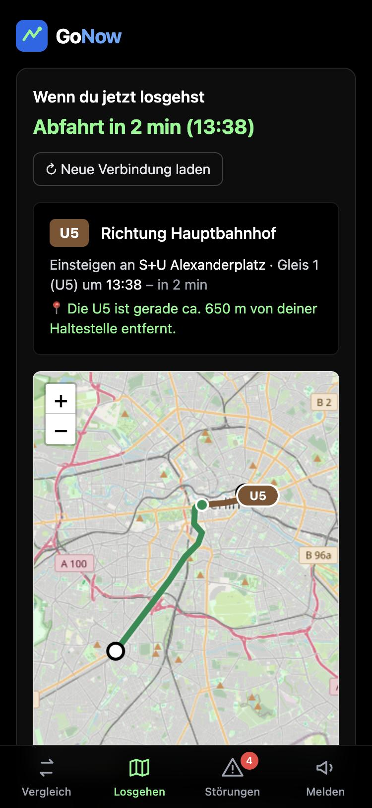
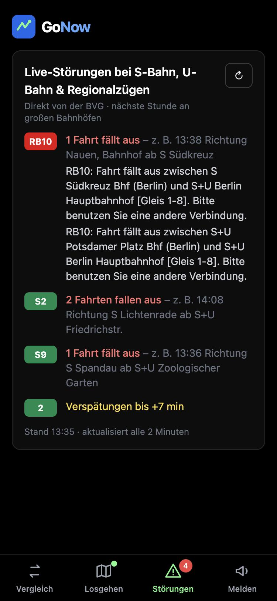

# GoNow – ÖPNV oder Auto? Der Pendler-Vergleich für Berlin

**Live ausprobieren: [qelos7.github.io/gonow](https://qelos7.github.io/gonow/)** (am besten auf dem Handy)

GoNow vergleicht für eine Strecke in Berlin die **echte, aktuelle BVG-Verbindung** mit **Auto, Fahrrad und Fußweg** – nach Dauer *und* Kosten. Dazu zeigt die App, wann man losgehen muss, wo die Bahn gerade fährt und welche Linien aktuell gestört sind.

| Vergleich | Losgehen | Störungen |
|:---:|:---:|:---:|
|  |  |  |

---

## Das Problem

Wer in Berlin pendelt, fragt sich oft: *Lohnt sich heute das Auto, oder bin ich mit der Bahn schneller und günstiger?* Kartendienste zeigen zwar Routen, aber selten einen ehrlichen Vergleich, der Parkplatzsuche, Parkgebühren, den passenden Fahrschein oder ein vorhandenes Deutschlandticket berücksichtigt.

## Was GoNow kann

- **Ortssuche mit Live-Vorschlägen** für Haltestellen und Adressen, bedienbar per Tastatur – oder mit einem Tipp auf „Mein Standort“
- **150 bekannte Berliner Hotels** direkt in der Suche (z. B. „Adlon“, „Hilton“, „Motel One Alex“) – praktisch für Taxifahrten ab oder zum Hotel
- **Echte ÖPNV-Verbindung** von der BVG mit Abfahrt, Ankunft, Umstiegen und Linien; ausgefallene Verbindungen werden automatisch übersprungen
- **Echte Routen für Auto, Taxi, Fahrrad und Fußweg** über den OpenStreetMap-Routenplaner, mit Knöpfen zum Öffnen in Apple Karten oder Google Maps
- **Taxipreis nach Berliner Taxitarif**, mit Aufschlüsselung nach Grundpreis und Kilometerstufen
- **Kostenvergleich** mit dem richtigen VBB-Fahrschein, Spritkosten und Parkgebühren
- **Deutschlandticket-Schalter** inkl. Hinweis, ab wie vielen Fahrten im Monat es sich lohnt
- **„Wenn du jetzt losgehst“**: Countdown, Linie, Gleis, Verspätung und eine Karte mit der **Live-Position der Bahn** (alle 15 Sekunden aktualisiert)
- **Live-Störungen** bei S-Bahn, U-Bahn und Regionalzügen (Ausfälle, Teilausfälle, Verspätungen) sowie Warnhinweise zur eigenen Verbindung
- **Anonyme Meldungen von Nutzern** (Stau, Störung): nur über feste Auswahllisten (Linie/Straße, Art), für alle Geräte sichtbar, verschwinden nach 10 Minuten automatisch
- **Handy-Ansicht wie eine App** mit Tab-Leiste; lässt sich auf den Home-Bildschirm legen

## So rechnet GoNow

| Was | Regel |
|---|---|
| **Fahrschein** (VBB-Tarif seit 1.1.2026) | Kurzstrecke **2,80 €** (bis 3 Stationen S-/U-Bahn oder 6 Haltestellen Bus/Tram ohne Umsteigen) · Einzelfahrschein AB **4,00 €** (ganz Berlin) · ABC **5,00 €** (sobald die Fahrt Berlin verlässt, z. B. Potsdam oder BER) |
| **Deutschlandticket** | 63 €/Monat → Einzelfahrt kostet 0 € extra; „lohnt sich ab“ = 63 € ÷ Einzelpreis |
| **Auto – Zeit** | Routenplaner-Fahrzeit × 1,35 (Berliner Verkehr) + Parkplatzsuche (10 min innerhalb des S-Bahn-Rings, sonst 4 min) + 2 min Fußweg |
| **Auto – Kosten** | Sprit (7 l/100 km × 1,75 €/l) + Parken 3 €/h, wenn das Ziel innerhalb des S-Bahn-Rings liegt; Parkdauer wählbar |
| **Taxi** | Berliner Taxitarif (seit Juni 2024): Grundpreis 4,30 € + 2,80 €/km (1.–3. km) + 2,60 €/km (4.–7. km) + 2,10 €/km (ab 8. km), auf 10 Cent gerundet; Fahrzeit wie Auto, aber ohne Parkplatzsuche; Wartezeit im Stau (39 €/h) nicht eingerechnet |
| **Fahrrad & Fußweg** | Dauer und Strecke direkt vom Routenplaner, kostenlos |

Ob ein Ziel im S-Bahn-Ring liegt, prüft GoNow geometrisch anhand der Ringbahn-Bahnhöfe; ob eine Haltestelle in Berlin liegt (Tarifbereich AB vs. C), am Haltestellennamen und an den Koordinaten.

## Datenquellen

| Daten | Quelle |
|---|---|
| Haltestellen, Verbindungen, Zugpositionen, Störungen | BVG über die offene Schnittstelle [v6.bvg.transport.rest](https://v6.bvg.transport.rest/) |
| Routen für Auto, Fahrrad, Fußweg | [routing.openstreetmap.de](https://routing.openstreetmap.de/) (FOSSGIS e. V.) |
| Karte | © [OpenStreetMap](https://www.openstreetmap.org/copyright)-Mitwirkende |
| Hotelliste (150 Hotels) | OpenStreetMap, ausgewählt nach Wikipedia-/Wikidata-Eintrag, Sternen, Zimmerzahl und Hotelkette; zwei Hotels über die BVG-Ortssuche ergänzt |
| Fahrpreise | [VBB-Tarif ab 1. Januar 2026](https://www.vbb.de/news/neue-fahrpreise-im-vbb-ab-1-januar-2026/) |
| Nutzer-Meldungen (gemeinsam für alle Geräte) | [ntfy.sh](https://ntfy.sh/) – kostenloser Nachrichtendienst, kein Konto nötig |

**Datenschutz:** keine Cookies, kein Tracking, kein Nutzerkonto. Alle Programmteile (React, Leaflet, Tailwind, Babel) liegen im Projekt selbst, es werden keine fremden Programm-Server (CDNs) angefragt. Meldungen sind anonym und bestehen nur aus Werten fester Auswahllisten; die App zeigt sie 10 Minuten lang an. Vor der ersten Standortabfrage erklärt die App, wohin der Standort gesendet wird. Einstellungen merkt sich nur der eigene Browser. Details und Kontakt in der [Datenschutzerklärung](datenschutz.html). GoNow ist ein privates, nicht kommerzielles Projekt.

## Technik

- **React 18** (Oberfläche), **Tailwind CSS** (Design), **Leaflet** (Karte)
- Bewusst als **eine HTML-Datei plus die Programmteile als eigene Dateien im Projekt** ohne Build-Schritt gebaut: läuft sofort im Browser, braucht keine Installation, lädt nichts von fremden Programm-Servern und lässt sich kostenlos über **GitHub Pages** veröffentlichen
- Live-Daten werden direkt im Browser abgefragt; mehrere Anfragen laufen parallel, veraltete Suchanfragen werden abgebrochen

## Entstehung & meine Rolle

GoNow begann als Prototyp, den ich bei einem **AWS-Workshop mit dem KI-Werkzeug Kiro** gebaut habe. Die Aufgabe: in kurzer Zeit von Grund auf ein Produkt entwickeln, das man im Alltag wirklich braucht, und es als Prototyp vorstellen. Wegen der knappen Zeit lief der Prototyp aber nicht zuverlässig.

An einem Sonntag habe ich mich deshalb hingesetzt und mir eine Frage gestellt: Wie weit komme ich **ohne Programmierkenntnisse** und ohne besondere Prompting-Tricks, bis zu einem Produkt, das wirklich online ist? Das Programmieren hat **Claude** (KI-Assistent von Anthropic) übernommen. Von mir kamen die Ideen, die Entscheidungen, was die App können soll, das Testen und die Veröffentlichung.

Das Ergebnis: Aus dem fehlerhaften Prototyp wurde an einem Tag eine funktionierende Web-App mit Live-Daten der BVG, echten Routen, korrekten Tarifen, einer Taxifunktion für meinen Vater, einer Handy-Ansicht und einer Datenschutzerklärung.

Wichtige Schritte vom Prototyp zur heutigen App:

1. **Fehleranalyse:** Die Suche fand keine einzige Haltestelle (falsch ausgelesene Koordinaten), Verbindungsfehler wurden verschluckt, alte Eingaben blieben gespeichert, die Tastatur funktionierte nicht.
2. **Live-Karte** mit Route und Echtzeit-Position der Bahn
3. **Ehrlicher Vergleich:** echte Routen statt Luftlinie, richtige Tarifzonen und aktuelle Preise, Deutschlandticket, Parkkosten
4. **Echte Störungsdaten** der BVG statt erfundener Beispielmeldungen
5. **Handy-Ansicht** mit Tab-Leiste und Veröffentlichung über GitHub Pages
6. **Zuverlässigkeit:** ausgefallene Verbindungen werden übersprungen
7. **Gemeinsame Meldungen:** Meldungen eines Geräts erscheinen nach spätestens 20 Sekunden auf allen anderen

## Grenzen

- Auto-Zeiten und -Kosten sind **Schätzungen** (Verkehrsaufschlag, Spritpreis, Parkgebühr sind Annahmen); Versicherung und Wertverlust sind nicht eingerechnet.
- Die genutzten Dienste sind **kostenlose Gemeinschaftsangebote ohne Garantie** und nur für geringe Nutzung gedacht.
- Die Störungsliste fragt **9 große Knotenbahnhöfe** ab, weil die Schnittstelle keine Gesamtliste anbietet; Störungen am Stadtrand und bei Bus/Tram können fehlen.
- Nutzer-Meldungen laufen über einen **öffentlichen Kanal** ohne Anmeldung. Die App zeigt aber nur Meldungen an, deren Werte exakt aus den festen Auswahllisten stammen – Freitext, Namen oder eingeschleuster Code werden verworfen. Falsche Meldungen (z. B. erfundene Störungen) lassen sich so nicht völlig verhindern.

## Ideen für später

· Abfahrtszeit wählen 
· Start/Ziel tauschen 
· Lieblingsstrecken speichern 
· mehrere Verbindungen zur Auswahl 
· Wetter und CO₂ einbeziehen 
· eigene Datenbank für Meldungen mit Anmeldung und Moderation 
· Umbau zu einem Projekt mit mehreren Dateien und automatischen Tests

## Selbst starten

Die Datei `index.html` herunterladen und über einen kleinen lokalen Webserver öffnen, zum Beispiel:

```bash
python3 -m http.server 8000
```

Dann im Browser `http://localhost:8000` aufrufen.
